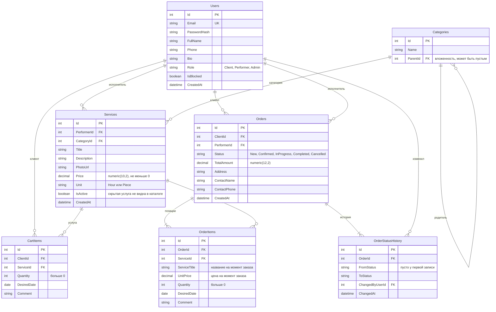

# ER-диаграмма FixHub

Диаграмма описывает таблицы базы данных PostgreSQL. Она отображается прямо на GitHub; для просмотра в другом редакторе нужна поддержка Mermaid.

## Ограничения и индексы

| Таблица | Ограничение или индекс |
|---------|------------------------|
| Users | уникальный индекс по `Email` |
| Categories | индекс по `ParentId` |
| Services | индексы по `CategoryId`, `Price`, `PerformerId`; проверка `Price >= 0` |
| CartItems | уникальная пара (`ClientId`, `ServiceId`); проверка `Quantity > 0` |
| Orders | индексы (`ClientId`, `Status`) и (`PerformerId`, `Status`) |
| OrderItems | индекс по `OrderId`; проверка `Quantity > 0` |
| OrderStatusHistory | индекс по `OrderId` |

## Правила удаления связанных записей

| Связь | Правило |
|-------|---------|
| Категория → подкатегории и услуги | запрет удаления (`Restrict`) |
| Пользователь → услуги, заказы, история статусов | запрет удаления (`Restrict`) |
| Услуга → позиции заказов | запрет удаления (`Restrict`) |
| Клиент → позиции корзины | каскадное удаление |
| Услуга → позиции корзины | каскадное удаление |
| Заказ → позиции и история статусов | каскадное удаление |

Вместо удаления услуга скрывается (`IsActive = false`), потому что на неё могут ссылаться заказы. Цена и название услуги копируются в `OrderItems` при оформлении заказа, поэтому последующее изменение услуги не влияет на старые заказы.
